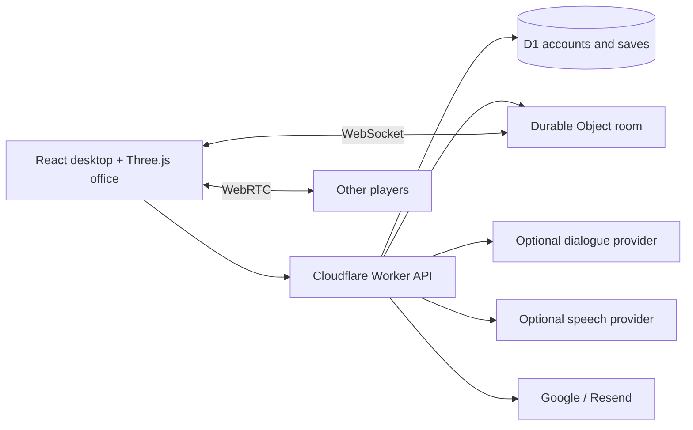

<div align="center">

# Scam With Your Friends — Web

> Betreib mit deinen Freunden ein Betrugs-Callcenter. Nutzt immer absurderen Tricks, um KI-Anrufern die Lebensersparnisse abzuluchsen. Erfüllt die Tagesquote, richtet Chaos im Büro an und übersteht die gnadenlose Leistungsbeurteilung eures jähzornigen Chefs.

<sub>Originalspielbeschreibung · [Steam](https://store.steampowered.com/app/4954910/Scam_With_Your_Friends/)</sub>

Scam With Your Friends Web ist ein **inoffizielles Open-Source-Browser-Remake**, inspiriert von Scam With Your Friends. Spielt kooperativ ein KI-Callcenter mit 3D-Büro, fiktiven Anrufern, Sprachchat und Tagesquoten. Gebaut mit React, Three.js und Cloudflare Workers; lokal starten oder selbst hosten.

> **Ist „Scam With Your Friends“ schon raus? Release-Datum & Playtest:** Das offizielle Spiel kommt von den Originalentwicklern und liegt bei [Steam](https://store.steampowered.com/app/4954910/Scam_With_Your_Friends/) — prüft die Store-Seite für aktuelles Release-Datum, Early Access und Playtest-Status, Termine können sich ändern. Dieses Repo ist eine **kostenlose, inoffizielle Fan-Browserversion**, die ihr [jetzt spielen](https://scam.gamefun.world) könnt, während ihr wartet. Fragen? Siehe die [FAQ](https://github.com/mrzh7/scam-with-your-friends-web/discussions).

**Letztes Update (2026-10-13):** erweiterte Kampagne und Koop-Features (auch ohne Account); Fixes am Rainbit-Spielautomaten mit gespeicherten Ergebnissen und neuen gestaffelten Walzen-Animationen.

### Online-Koop-Callcenter-Partyspiel · Job-Simulator · schwarze Komödie, im Browser

**Beantwortet fiktive KI-Anrufer, sprecht per Voice mit dem Team, managt eure Zeit, erfüllt die Tagesquote und übersteht die Leistungsbeurteilung.**

[English](README.md) · [简体中文](README.zh-CN.md) · [Português](README.pt-BR.md) · [Español](README.es.md) · [日本語](README.ja.md) · **Deutsch** · [Feedback](https://github.com/mrzh7/scam-with-your-friends-web/issues/new/choose) · [Русский](README.ru.md)

<p align="center">
  <a href="https://scam.gamefun.world"><strong>▶ Demo spielen</strong></a>
  &nbsp;·&nbsp;
  <a href="#trailer-anschauen"><strong>Trailer</strong></a>
  &nbsp;·&nbsp;
  <a href="#so-spielt-ihr"><strong>Gameplay</strong></a>
  &nbsp;·&nbsp;
  <a href="docs/DEPLOYMENT.md"><strong>Deploy</strong></a>
  &nbsp;·&nbsp;
  <a href="docs/QUICKSTART.md"><strong>Docs</strong></a>
</p>

<p align="center">
  <a href="LICENSE"></a>
  <a href="https://scam.gamefun.world"></a>
  
  
  
  <a href=".github/workflows/ci.yml"></a>
  <a href="https://x.com/mr_zh7"></a>
</p>

<!-- Ranking badges (uncomment when live — do not leave broken images):
  Trendshift appears only after the repo is listed at https://trendshift.io
  (replace REPO_ID with the id shown on https://trendshift.io/repositories/<id>):
  <a href="https://trendshift.io/repositories/REPO_ID" target="_blank"></a>
  Star History rank badge (works only once the repo is in their ranking):
  <a href="https://www.star-history.com/mrzh7/scam-with-your-friends-web"></a>
-->

[](docs/media/trailer-preview.gif)

</div>

> **Erweiterungs-Update:** Neue Kampagnen bringen acht Ermittlungs-Workflows, kontextuelle Dialoge, Zufallsereignisse, öffentliche Lobbys, Anrufweiterleitungen, Team-Hilfe, eigene Charaktere, Aufnahme/Wiederholungen und Büro-Präsentations-Updates. **Voice-Cloning und Team-Voice-Buttons sind vorübergehend deaktiviert**; Standard-Anrufer-TTS und Studio-Aufnahme bleiben verfügbar. Bestehende Speicherstände behalten die klassischen Regeln. Siehe [Erweiterungshinweise](docs/EXPANSION.md) zu Migration und Self-Hosting.

## Inspiriert vom offiziellen Spiel

**Offizieller Store:** [Scam With Your Friends auf Steam](https://store.steampowered.com/app/4954910/Scam_With_Your_Friends/)

<p align="center">
  <a href="https://store.steampowered.com/app/4954910/Scam_With_Your_Friends/"></a>
</p>

<p align="center">
  <a href="https://store.steampowered.com/app/4954910/Scam_With_Your_Friends/"></a>
  <a href="https://store.steampowered.com/app/4954910/Scam_With_Your_Friends/"></a>
</p>
<p align="center">
  <a href="https://store.steampowered.com/app/4954910/Scam_With_Your_Friends/"></a>
  <a href="https://store.steampowered.com/app/4954910/Scam_With_Your_Friends/"></a>
</p>

Dieses Repository ist ein **inoffizielles, kostenloses Browser-Experiment**. Es ist **nicht** das Originalspiel, **kein** offizielles Port und **nicht mit den Originalentwicklern verbunden**. Der Steam-Header und die Screenshots oben sind © ihrer Rechteinhaber und werden **nur als Hotlink von Steam zur Referenz** gezeigt — sie liegen nicht in diesem Repo. Siehe [THIRD_PARTY_NOTICES.md](THIRD_PARTY_NOTICES.md).

**Scam With Your Friends — Web** ist ein inoffizielles, kostenloses Remake, das ihr im Browser unter [scam.gamefun.world](https://scam.gamefun.world) spielen könnt: betreibt ein **Betrugs-Callcenter mit Freunden**, nutzt immer absurderen Tricks gegen **KI-Anrufer**, erfüllt die **Tagesquote**, sorgt für **Büro-Chaos** und übersteht die brutale **Leistungsbeurteilung** vom Chef. Zum Schreibtisch laufen, sprechen (getippt oder mit **Sprachsteuerung**, wo unterstützt), Desktop-Aufgaben für Ingame-Geld erledigen und kooperativ mit bis zu vier Spielern spielen. Alles ist fiktiv; nie echte Zahlungsdaten eingeben.


## Screenshots

[](docs/media/screenshot-wall.png)

| Three.js-Büro | Eingehender Anruf | Hauptmenü |
| --- | --- | --- |
| Laufen, setzen, shoppen und Lieferungen abholen | Mit KI-Anrufern sprechen, Aufgabe erledigen | Solo, Koop-Raumcode, Einstellungen |

Aufnahmen aus dieser Implementierung mit synthetischem Testaccount und Offline-Dialog — kein Footage aus dem Originalspiel. Einzelbilder: [Büro](docs/media/office.png), [Desktop](docs/media/desktop.png), [Menü](docs/media/menu.png).

## Features

| System | Umsetzung |
| --- | --- |
| Büro | Prozedurales Three.js-Zimmer, Bewegung, Interaktion, Equipment und Sitz-Animation |
| Anrufe | Acht KI-Anrufer-Profile, Vertrauen/Geduld, skriptierte Offline-Antworten, optionaler KI-Dialog |
| Arbeitswoche | Sieben Tage, Tagesquoten-Timer, Shop, Lieferungsabholung, Inventar, Unfälle und Leistungsbeurteilung |
| Stimme | Sprachsteuerung per Spracherkennung (wo unterstützt), Team-Voice-Chat, optionales MiniMax- oder ElevenLabs-TTS |
| Koop | Online-Koop für bis zu vier Spieler, WebSocket-State, geteilter Tag/Quote und WebRTC-Voice |
| Accounts | Optional; standardmäßig aus. Google oder verifizierte E-Mail/Passwort über Resend |
| Speicherstände | D1-Account-Saves, Revisions-Konfliktprüfung und lokale Wiederherstellung/Export |
| Sprachen | Englisch, Chinesisch, Portugiesisch, Japanisch, Spanisch, Russisch, Deutsch |

## Warum spielen

- **Online-Koop für bis zu vier** — teilt Tag und Quote, jeder mit eigenen Anrufen, plus Nähe-Team-Voice.
- **KI-Anrufer** — acht fiktive Persönlichkeiten; skriptierte Offline-Antworten laufen ohne Key, optionale KI für freies Gespräch.
- **Zeitmanagement unter Druck** — sieben Tage, steigende Tagesquoten, Shop mit Upgrades und Lieferungen zum Abholen.
- **Büro-Chaos** — Virus, Blackout, Feuer und Razzia-Unfälle unterbrechen die Routine.
- **Schwarze Komödie** — absurde, fiktive Szenarien und ein gnadenloser Chef; nichts Echtes wird erfasst.
- **Nichts zu installieren** — läuft im Browser; sieben UI-Sprachen; Self-Host auf Cloudflare für Free-Tier-Experimente.

## Trailer anschauen

https://github.com/user-attachments/assets/4c90325b-0fb6-4102-877f-55c378ca5371

**[▶ Englisch · 1080p mit Ton](docs/media/trailer-en.mp4)** · **[▶ Version mit chinesischen Untertiteln](docs/media/trailer-zh-CN.mp4)** · [Poster](docs/media/trailer-poster.jpg) · [Original-Soundtrack](docs/media/trailer-score.mp3)

Kino-Animation aus Büro, Charakteren und Porträts dieses Projekts, mit Originalmusik. Dialog und Action sind für den Trailer inszeniert. [Storyboard und Rendering](marketing/trailer/README.md).

**[Gehostete Demo spielen → https://scam.gamefun.world](https://scam.gamefun.world)** — Google-Login oder verifizierte E-Mail in der Demo; **Source startet standardmäßig ohne Accounts**.

Nochmal: Das ist ein **inoffizielles** Browser-Remake, inspiriert von [Scam With Your Friends](https://store.steampowered.com/app/4954910/Scam_With_Your_Friends/) — nicht das Original, kein offizielles Port, nicht mit den Entwicklern verbunden. Siehe [Herkunft und Lizenzen](THIRD_PARTY_NOTICES.md). Alle Aufgaben-IDs, Karten, Beträge und Events sind fiktiv. **Keine echten Zahlungsdaten eingeben.**

## So spielt ihr

1. **Setzt euch an den Schreibtisch** — WASD zum Bewegen, **E** zum Setzen. Mobil gibt’s On-Screen-Steuerung.
2. **Nehmt den Anruf an** — lest den KI-Anrufer, managt Vertrauen und Geduld; Offline-Antwortbuttons oder optional KI-Dialog und Stimme.
3. **Erledigt die Desktop-Aufgabe** — Verifizierungsschritte für Ingame-Geld abschließen (nie echte Kartendaten nutzen).
4. **Shoppen und Lieferungen abholen** — Upgrades installieren sofort; physische Items müsst ihr im Büro abholen.
5. **Erfüllt die Tagesquote**, bevor der Schicht-Timer endet, und besteht die Leistungsbeurteilung — sonst ist der Run vorbei. Koop: bis zu vier Spieler teilen den Tag; **V** für Team-Voice.

Vollständige Regeln: [Gameplay-Guide (Englisch)](docs/GAMEPLAY-EN.md) — Rundenablauf, Steuerung, Anrufe und Vertrauen, Tools, Geld, Shop-Items, Unfälle, Koop-Voice und Audio-Hinweise. Auch auf: [简体中文](docs/GAMEPLAY.md) · [Português](docs/GAMEPLAY-PT.md) · [Español](docs/GAMEPLAY-ES.md) · [日本語](docs/GAMEPLAY-JA.md). *(Noch kein deutsches Gameplay-Dokument — bitte den englischen Guide nutzen.)*

## Quick Start — ohne Accounts

```sh
git clone https://github.com/mrzh7/scam-with-your-friends-web.git
cd scam-with-your-friends-web
npm ci
cp .dev.vars.example .dev.vars   # PowerShell: Copy-Item .dev.vars.example .dev.vars
npm run dev
```

Öffnet **http://localhost:5173**. Kein Cloudflare-Login, OAuth oder E-Mail-Dienst nötig. KI-Key leer lassen für skriptiertes Offline-Spiel.

Optionale KI in `.dev.vars`:

```dotenv
ACCOUNTS_ENABLED=false
AI_BASE_URL=https://api.deepseek.com
AI_MODEL=deepseek-v4-flash
AI_API_KEY=your-own-provider-key
```

Fortschritt ist pro Browser über ein anonymes Cookie. Backups exportieren, bevor Cookies gelöscht werden. Details: [lokaler Guide](docs/QUICKSTART.md).

## Auf Cloudflare deployen

Setzt **`ACCOUNTS_ENABLED=true`**, wenn ihr Login wollt, legt eine eigene D1-Datenbank an, konfiguriert mindestens eine Auth-Methode und folgt **[DEPLOYMENT.md](docs/DEPLOYMENT.md)**. Workers + Static Assets + D1 + Durable Objects — keine rein statische Pages-App. Provider-Zugangsdaten sind nie enthalten; bezahlte APIs können Kosten verursachen, auch wenn der Source kostenlos ist.

## Architektur



`src/game/` — gemeinsame Regeln, Dialog, Saves, Browser-Transports. `worker/` — Auth, API, Provider, Raum-Authority. `migrations/` — D1-Schema.

## Entwicklung

```sh
npm run check          # Public-tree checks, i18n, tests, TypeScript and production build
npm test
npm run check:i18n
```

Siehe [Acceptance-Notes](docs/ACCEPTANCE.md), [SECURITY.md](SECURITY.md) und [Datenfluss](docs/PRIVACY.md). Bekannte Limits: mobiles WebGL/Speech variiert; kein Zahlungssystem; clientseitig eingereichte Singleplayer-Saves eignen sich nicht für Echtgeld-Belohnungen.

## Feedback & Community

Bug gefunden oder Idee? Meldet euch:

- [Bug melden](https://github.com/mrzh7/scam-with-your-friends-web/issues/new?template=bug_report.yml)
- [Feature vorschlagen](https://github.com/mrzh7/scam-with-your-friends-web/issues/new?template=feature_request.yml)
- [Discussions (Q&A, Ideen)](https://github.com/mrzh7/scam-with-your-friends-web/discussions)
- [Security-Policy](SECURITY.md)
- Kontakt: X [@mr_zh7](https://x.com/mr_zh7)

## Mitwirken

Sinnvolle Bereiche: mobile Kompatibilität, natürliche Übersetzungen, Barrierefreiheit und zuverlässiges Voice-Reconnect. Siehe [CONTRIBUTING.md](CONTRIBUTING.md). Security-Themen: [SECURITY.md](SECURITY.md).

## Buy me a coffee

<p align="center">Wenn euch das Projekt zum Lachen gebracht hat, könnt ihr mir einen Kaffee spendieren. Tips sind **freiwillig**: keine Perks, keine Rückerstattung. Das ist ein inoffizielles Fan-Projekt, nicht mit dem Originalspiel verbunden.</p>

<table width="100%"><tr>
<td width="33%" align="center" valign="top">
<a href="docs/donate/eth-qr.png"></a><br/>
<b>ETH</b><br/>
<sub>Ethereum / EVM — Netzwerk prüfen</sub>
</td>
<td width="33%" align="center" valign="top">
<a href="docs/donate/btc-qr.png"></a><br/>
<b>BTC</b><br/>
<sub>Bitcoin</sub>
</td>
<td width="33%" align="center" valign="top">
<a href="docs/donate/bnb-qr.png"></a><br/>
<b>BNB</b><br/>
<sub>Nur BNB Smart Chain (BEP20)</sub>
</td>
</tr></table>

<p align="center">⚠️ QR oben scannen. Tips sind freiwillig. Ich werde euch nie per DM eine neue Adresse schicken — vertraut nur den Codes in diesem README.</p>

## Häufig gestellte Fragen

### Ist das das offizielle Scam With Your Friends-Spiel?

Nein. Das ist eine unabhängige Fan-Webversion, nicht die Steam-Veröffentlichung und kein offizielles Port. Es ist nicht mit den Originalentwicklern verbunden.

### Kann ich ohne Account oder KI-API-Key spielen?

Ja. Der Source startet mit deaktivierten Accounts und enthält skriptierte Offline-Anrufe. Freier KI-Dialog und optionales Cloud-TTS brauchen eure eigene Provider-Konfiguration; Provider-Nutzung kann kosten. Siehe [Quick Start](docs/QUICKSTART.md).

### Kann ich ein Multiplayer-Browserspiel selbst hosten?

Ja. Das Projekt bringt Koop-Räume, WebRTC-Voice-Chat und persistenten Fortschritt mit. Folgt dem [Deployment-Guide](docs/DEPLOYMENT.md) für Cloudflare Workers, D1 und Durable Objects, inkl. optionalem Google-/E-Mail-Login.

## Star History

<a href="https://www.star-history.com/?repos=mrzh7%2Fscam-with-your-friends-web&amp;type=date"><picture><source media="(prefers-color-scheme: dark)" srcset="https://api.star-history.com/chart?repos=mrzh7/scam-with-your-friends-web&amp;type=date&amp;theme=dark&amp;legend=top-left" /><source media="(prefers-color-scheme: light)" srcset="https://api.star-history.com/chart?repos=mrzh7/scam-with-your-friends-web&amp;type=date" /></picture></a>

<div align="center">

### Star · Teilen · Mitwirken

Wenn’s euch gefällt: **[Repo sternen](https://github.com/mrzh7/scam-with-your-friends-web)**, **[Demo spielen](https://scam.gamefun.world)** mit Freunden und teilen, **[auf X folgen](https://x.com/mr_zh7)**, oder Issue bzw. Pull Request öffnen.

</div>

Projekt-eigener Code steht unter [MIT](LICENSE). Drittnamen, Referenzwerke und Dependencies behalten ihre eigenen Rechte — siehe [THIRD_PARTY_NOTICES.md](THIRD_PARTY_NOTICES.md).
