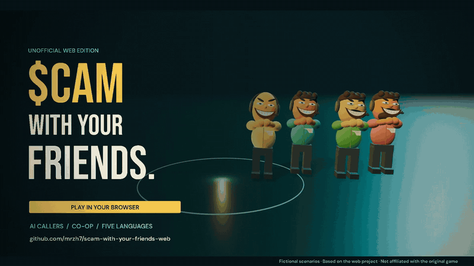
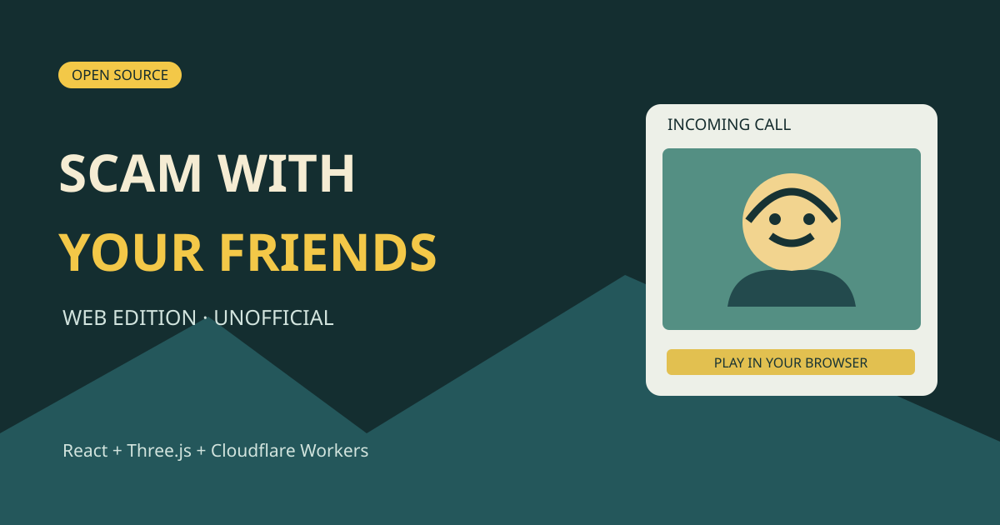
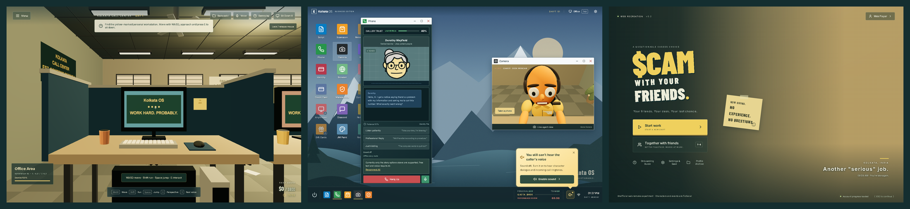
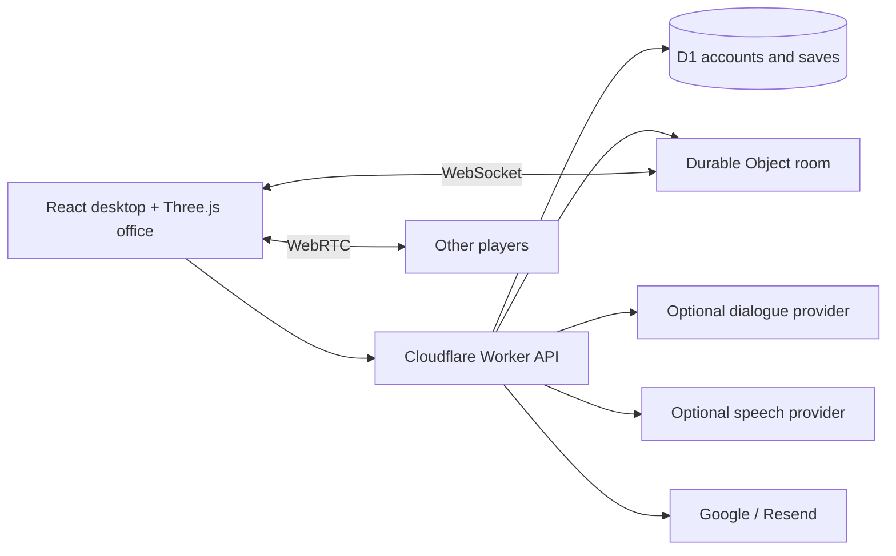
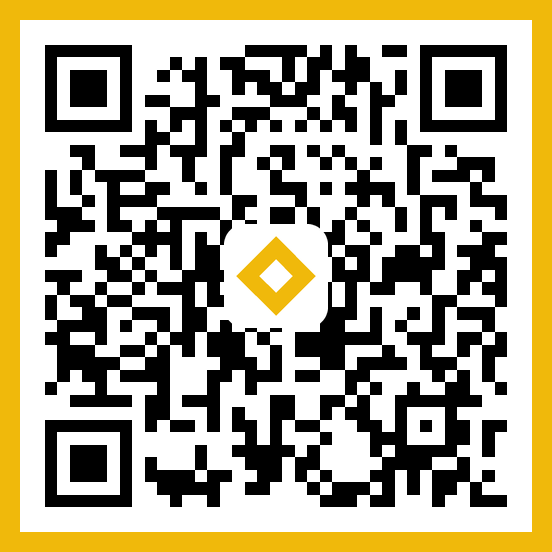

<div align="center">

# Scam With Your Friends — Web

> Управляйте колл-центром мошенников вместе с друзьями. Используйте всё более нелепые схемы, чтобы выманивать у клиентов под управлением ИИ их сбережения. Выполняйте дневную норму, устраивайте хаос в офисе и выживайте на жестокой аттестации от вспыльчивого начальника.

<sub>Описание оригинальной игры · [Steam](https://store.steampowered.com/app/4954910/Scam_With_Your_Friends/)</sub>

Scam With Your Friends Web — это **неофициальная браузерная версия с открытым исходным кодом**, вдохновлённая Scam With Your Friends. Играйте в кооперативную игру про колл-центр с ИИ с 3D-офисом, вымышленными звонящими, голосовым чатом и дневными нормами. Создано на React, Three.js и Cloudflare Workers; запускайте локально или размещайте самостоятельно.

> **Вышла ли «Scam With Your Friends»? Дата релиза и плейтест:** официальная игра создана её оригинальными разработчиками и опубликована в [Steam](https://store.steampowered.com/app/4954910/Scam_With_Your_Friends/) — проверяйте страницу магазина, чтобы узнать актуальную дату релиза, статус Early Access и плейтеста, так как даты могут меняться. Этот репозиторий — **бесплатная неофициальная фанатская браузерная версия**, в которую можно [поиграть прямо сейчас](https://scam.gamefun.world), пока вы ждёте. Вопросы? Смотрите [FAQ](https://github.com/mrzh7/scam-with-your-friends-web/discussions).

**Последнее обновление (2026-10-13):** расширенная кампания и кооперативные функции (также в режиме без аккаунта); исправления игрового автомата Rainbit с сохранением результатов и новыми ступенчатыми анимациями барабанов.

### Онлайн-кооперативная вечеринка в колл-центре · симулятор работы · чёрная комедия, прямо в вашем браузере

**Отвечайте вымышленным клиентам под управлением ИИ, общайтесь с командой по голосовой связи, управляйте своим временем, выполняйте дневную норму и выживайте на аттестации.**

[English](README.md) · [简体中文](README.zh-CN.md) · [Português](README.pt-BR.md) · [Español](README.es.md) · [日本語](README.ja.md) · [Обратная связь](https://github.com/mrzh7/scam-with-your-friends-web/issues/new/choose) · **Русский**

<p align="center">
  <a href="https://scam.gamefun.world"><strong>▶ Играть в демо</strong></a>
  &nbsp;·&nbsp;
  <a href="#watch-the-trailer"><strong>Трейлер</strong></a>
  &nbsp;·&nbsp;
  <a href="#how-to-play"><strong>Геймплей</strong></a>
  &nbsp;·&nbsp;
  <a href="docs/DEPLOYMENT.md"><strong>Развёртывание</strong></a>
  &nbsp;·&nbsp;
  <a href="docs/QUICKSTART.md"><strong>Документация</strong></a>
</p>

<p align="center">
  <a href="LICENSE"></a>
  <a href="https://scam.gamefun.world"></a>
  
  
  
  <a href=".github/workflows/ci.yml"></a>
  <a href="https://x.com/mr_zh7"></a>
</p>

<!-- Ranking badges (uncomment when live — do not leave broken images):
  Trendshift appears only after the repo is listed at https://trendshift.io
  (replace REPO_ID with the id shown on https://trendshift.io/repositories/<id>):
  <a href="https://trendshift.io/repositories/REPO_ID" target="_blank"></a>
  Star History rank badge (works only once the repo is in their ranking):
  <a href="https://www.star-history.com/mrzh7/scam-with-your-friends-web"></a>
-->

[](docs/media/trailer-preview.gif)

</div>

> **Обновление с расширением:** Новые кампании включают восемь следственных сценариев, контекстные диалоги, случайные происшествия, публичные лобби, переводы звонков, помощь команды, пользовательских персонажей, запись/повторы и обновления оформления офиса. **Клонирование голоса и командные голосовые кнопки временно отключены**; стандартный TTS звонящего и запись в Studio остаются доступными. Существующие сохранения сохраняют классические правила. Подробности миграции и самостоятельного размещения см. в [примечаниях к расширению](docs/EXPANSION.md).

## Вдохновлено официальной игрой

**Официальный магазин:** [Scam With Your Friends в Steam](https://store.steampowered.com/app/4954910/Scam_With_Your_Friends/)

<p align="center">
  <a href="https://store.steampowered.com/app/4954910/Scam_With_Your_Friends/"></a>
</p>

<p align="center">
  <a href="https://store.steampowered.com/app/4954910/Scam_With_Your_Friends/"></a>
  <a href="https://store.steampowered.com/app/4954910/Scam_With_Your_Friends/"></a>
</p>
<p align="center">
  <a href="https://store.steampowered.com/app/4954910/Scam_With_Your_Friends/"></a>
  <a href="https://store.steampowered.com/app/4954910/Scam_With_Your_Friends/"></a>
</p>

Этот репозиторий — **неофициальный бесплатный браузерный эксперимент**. Это **не** оригинальная игра, **не** официальный порт, и он **не связан** с оригинальными разработчиками. Заголовок и скриншоты Steam выше являются © их владельцев и **подключены напрямую со Steam только для справки** — они не хранятся в этом репозитории. См. [THIRD_PARTY_NOTICES.md](THIRD_PARTY_NOTICES.md).

**Scam With Your Friends — Web** — это неофициальная бесплатная ремейк-версия, в которую можно играть в браузере на [scam.gamefun.world](https://scam.gamefun.world): управляйте **колл-центром мошенников вместе с друзьями**, используйте всё более нелепые схемы, чтобы обманывать **клиентов под управлением ИИ**, выполняйте **дневную норму**, устраивайте **хаос в офисе** и выживайте на жестокой **аттестации** от начальника. Подойдите к своему столу, общайтесь (текстом или с помощью **голосового управления**, где это поддерживается), выполняйте задачи на компьютере за внутриигровые деньги и играйте в кооперативе до четырёх игроков. Всё вымышлено; никогда не вводите реальные платёжные данные.



## Скриншоты

[](docs/media/screenshot-wall.png)

| Офис на Three.js | Стол входящих звонков | Главное меню |
| --- | --- | --- |
| Ходите, садитесь, покупайте и забирайте доставки | Общайтесь с клиентами под управлением ИИ, выполняйте задачу | Одиночная игра, код комнаты кооператива, настройки |

Снято в этой реализации с синтетическим тестовым аккаунтом и офлайн-диалогами — не кадры из оригинальной игры. Отдельные снимки: [офис](docs/media/office.png), [рабочий стол](docs/media/desktop.png), [меню](docs/media/menu.png).

## Возможности

| Система | Реализация |
| --- | --- |
| Офис | Процедурная комната на Three.js, движение, взаимодействие, оборудование и анимация сидения |
| Звонки | Восемь профилей клиентов под управлением ИИ, доверие/терпение, сценарные офлайн-ответы, опциональный AI-диалог |
| Рабочая неделя | Семь дней, таймеры дневной нормы, магазин, получение доставок, инвентарь, происшествия и аттестация |
| Голос | Голосовое управление через распознавание речи, где поддерживается, командный голосовой чат, опциональный TTS MiniMax или ElevenLabs |
| Кооператив | Онлайн-кооператив до четырёх игроков, состояние через WebSocket, общий день/норма и голос через WebRTC |
| Аккаунты | Опционально; отключены по умолчанию. Google или подтверждённый email/пароль через Resend |
| Сохранения | Сохранения аккаунта в D1, обнаружение конфликтов ревизий и локальное восстановление/экспорт |
| Языки | Английский, китайский, португальский, японский, испанский, русский, немецкий |

## Зачем играть

- **Онлайн-кооператив до четырёх** — делите день и норму, каждый обрабатывает свои звонки, с командным голосом по близости.
- **Клиенты под управлением ИИ** — восемь вымышленных личностей; офлайн-сценарные ответы работают без ключа, опциональный AI для свободной беседы.
- **Управление временем под давлением** — семь дней, растущие дневные нормы, магазин с улучшениями и доставки, которые нужно забирать.
- **Хаос в офисе** — вирус, отключение электричества, пожар и рейд разнообразят рутину.
- **Тон чёрной комедии** — абсурдные вымышленные сценарии и безжалостный начальник; ничего реального не собирается.
- **Ничего не нужно устанавливать** — работает в браузере; семь языков интерфейса; самостоятельное размещение на Cloudflare для экспериментов на бесплатном тарифе.

<a id="watch-the-trailer"></a>

## Смотреть трейлер

https://github.com/user-attachments/assets/4c90325b-0fb6-4102-877f-55c378ca5371

**[▶ English · 1080p with sound](docs/media/trailer-en.mp4)** · **[▶ 中文字幕版](docs/media/trailer-zh-CN.mp4)** · [Постер](docs/media/trailer-poster.jpg) · [Оригинальный саундтрек](docs/media/trailer-score.mp3)

Кинематографическая анимация, созданная на основе офиса, персонажей и портретов этого проекта, с оригинальной музыкой. Диалоги и действия поставлены для трейлера. [Раскадровка и рендеринг](marketing/trailer/README.md).

**[Играть в размещённое демо → https://scam.gamefun.world](https://scam.gamefun.world)** — вход через Google или подтверждённый email в демо; **исходный код по умолчанию без аккаунтов**.

Ещё раз: это **неофициальная** браузерная ремейк-версия, вдохновлённая [Scam With Your Friends](https://store.steampowered.com/app/4954910/Scam_With_Your_Friends/) — не оригинал, не официальный порт, не связана с её разработчиками. См. [происхождение и лицензии](THIRD_PARTY_NOTICES.md). Все ID задач, карты, средства и события вымышлены. **Не вводите реальные платёжные данные.**

<a id="how-to-play"></a>

## Как играть

1. **Сядьте за свой стол** — WASD для движения, **E** чтобы сесть. На мобильных есть экранные элементы управления.
2. **Ответьте на звонок** — читайте реплики клиента под управлением ИИ, управляйте доверием и терпением; используйте кнопки офлайн-ответов или опциональный AI-диалог и голос.
3. **Выполните задачу на компьютере** — завершите шаги проверки за внутриигровые деньги (никогда не используйте реальные данные карты).
4. **Покупайте и забирайте доставки** — улучшения устанавливаются сразу; физические предметы нужно забрать в офисе.
5. **Выполните дневную норму** до окончания таймера смены и пройдите аттестацию — пропустите, и забег окончен. Кооператив: до четырёх игроков делят день; **V** для командного голоса.

Полные правила: [Руководство по геймплею](docs/GAMEPLAY-EN.md) — цикл раунда, управление, звонки и доверие, инструменты, деньги, товары в магазине, происшествия, командный голос и заметки по аудио. Также на: [简体中文](docs/GAMEPLAY.md) · [Português](docs/GAMEPLAY-PT.md) · [Español](docs/GAMEPLAY-ES.md) · [日本語](docs/GAMEPLAY-JA.md).

## Быстрый старт — без аккаунтов

```sh
git clone https://github.com/mrzh7/scam-with-your-friends-web.git
cd scam-with-your-friends-web
npm ci
cp .dev.vars.example .dev.vars   # PowerShell: Copy-Item .dev.vars.example .dev.vars
npm run dev
```

Откройте **http://localhost:5173**. Не требуется вход в Cloudflare, OAuth или почтовый сервис. Оставьте ключ AI пустым для сценарной офлайн-игры.

Опциональный AI в `.dev.vars`:

```dotenv
ACCOUNTS_ENABLED=false
AI_BASE_URL=https://api.deepseek.com
AI_MODEL=deepseek-v4-flash
AI_API_KEY=your-own-provider-key
```

Прогресс хранится в каждом браузере через анонимный cookie. Экспортируйте резервные копии перед очисткой cookies. Подробности: [локальное руководство](docs/QUICKSTART.md).

## Развёртывание на Cloudflare

Установите **`ACCOUNTS_ENABLED=true`**, если хотите вход, создайте собственную базу данных D1, настройте хотя бы один метод аутентификации, затем следуйте **[DEPLOYMENT.md](docs/DEPLOYMENT.md)**. Workers + Static Assets + D1 + Durable Objects — это не приложение Pages только со статикой. Учётные данные провайдеров никогда не включаются; платные API могут взимать плату, хотя исходный код бесплатен.

## Архитектура



`src/game/` — общие правила, диалоги, сохранения, браузерные транспорты. `worker/` — аутентификация, API, провайдеры, авторитет комнаты. `migrations/` — схема D1.

## Разработка

```sh
npm run check          # Public-tree checks, i18n, tests, TypeScript and production build
npm test
npm run check:i18n
```

См. [заметки о приёмке](docs/ACCEPTANCE.md), [SECURITY.md](SECURITY.md) и [поток данных](docs/PRIVACY.md). Известные ограничения: мобильные WebGL/речь различаются; нет платёжной системы; отправляемые клиентом одиночные сохранения непригодны для наград за реальные деньги.

## Обратная связь и сообщество

Нашли баг или есть идея? Расскажите нам:

- [Сообщить о баге](https://github.com/mrzh7/scam-with-your-friends-web/issues/new?template=bug_report.yml)
- [Запросить функцию](https://github.com/mrzh7/scam-with-your-friends-web/issues/new?template=feature_request.yml)
- [Обсуждения (вопросы и ответы, идеи)](https://github.com/mrzh7/scam-with-your-friends-web/discussions)
- [Политика безопасности](SECURITY.md)
- Контакт: X [@mr_zh7](https://x.com/mr_zh7)

## Участие в разработке

Полезные направления: мобильная совместимость, естественные переводы, доступность и надёжное переподключение голоса. См. [CONTRIBUTING.md](CONTRIBUTING.md). Проблемы безопасности: [SECURITY.md](SECURITY.md).

## Купите мне кофе

<p align="center">Если этот проект заставил вас посмеяться, вы можете купить мне кофе. Чаевые **добровольны**: без бонусов, без возврата. Это неофициальный фанатский проект, не связанный с оригинальной игрой.</p>

<table width="100%"><tr>
<td width="33%" align="center" valign="top">
<a href="docs/donate/eth-qr.png"></a><br/>
<b>ETH</b><br/>
<sub>Ethereum / EVM — confirm network</sub>
</td>
<td width="33%" align="center" valign="top">
<a href="docs/donate/btc-qr.png"></a><br/>
<b>BTC</b><br/>
<sub>Bitcoin</sub>
</td>
<td width="33%" align="center" valign="top">
<a href="docs/donate/bnb-qr.png"></a><br/>
<b>BNB</b><br/>
<sub>BNB Smart Chain (BEP20) only</sub>
</td>
</tr></table>

<p align="center">⚠️ Сканируйте QR-код выше. Чаевые добровольны. Я никогда не пришлю вам новый адрес в личных сообщениях — доверяйте только кодам в этом README.</p>

## Часто задаваемые вопросы

### Это официальная игра Scam With Your Friends?

Нет. Это независимая фанатская веб-версия, не релиз в Steam и не официальный порт. Она не связана с оригинальными разработчиками.

### Можно ли играть без аккаунта или ключа AI API?

Да. Исходный код по умолчанию имеет отключённые аккаунты и включает офлайн-сценарные звонки. Свободный AI-диалог и опциональный облачный TTS требуют вашей собственной конфигурации провайдера; использование провайдера может стоить денег. См. [быстрый старт](docs/QUICKSTART.md).

### Могу ли я сам разместить многопользовательскую браузерную игру?

Да. Проект включает комнаты кооператива, голосовой чат WebRTC и постоянный прогресс. Следуйте [руководству по развёртыванию](docs/DEPLOYMENT.md) для Cloudflare Workers, D1 и Durable Objects, включая опциональный вход через Google/email.

## История звёзд

<a href="https://www.star-history.com/?repos=mrzh7%2Fscam-with-your-friends-web&amp;type=date"><picture><source media="(prefers-color-scheme: dark)" srcset="https://api.star-history.com/chart?repos=mrzh7/scam-with-your-friends-web&amp;type=date&amp;theme=dark&amp;legend=top-left" /><source media="(prefers-color-scheme: light)" srcset="https://api.star-history.com/chart?repos=mrzh7/scam-with-your-friends-web&amp;type=date" /></picture></a>

<div align="center">

### Звезда · Поделиться · Внести вклад

Если вам нравится, **[поставьте звезду репозиторию](https://github.com/mrzh7/scam-with-your-friends-web)**, **[поиграйте в демо](https://scam.gamefun.world)** с друзьями и поделитесь им, **[подпишитесь в X](https://x.com/mr_zh7)** или откройте issue или pull request.

</div>

Код, принадлежащий проекту, распространяется под [MIT](LICENSE). Сторонние названия, справочные материалы и зависимости сохраняют свои собственные права — см. [THIRD_PARTY_NOTICES.md](THIRD_PARTY_NOTICES.md).
